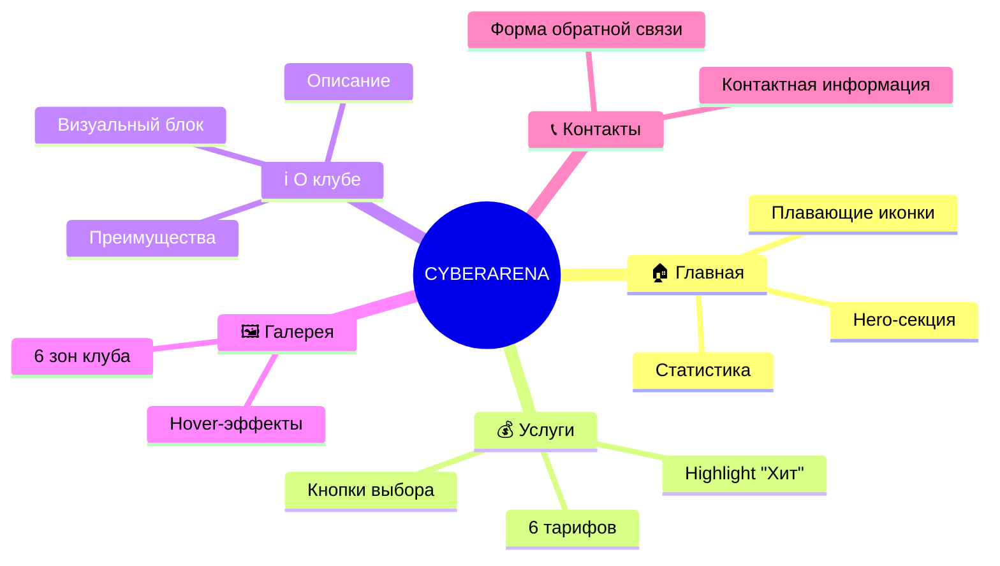
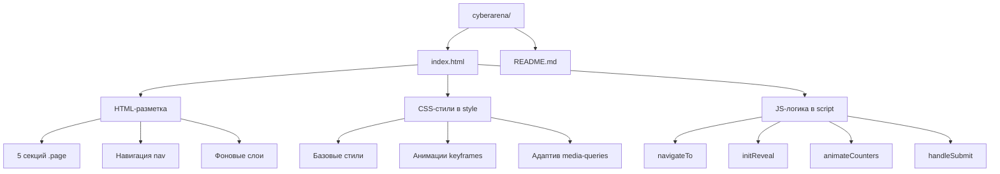
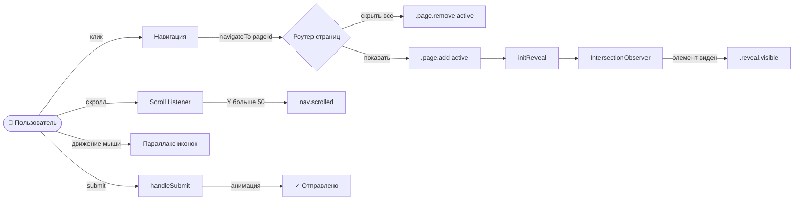
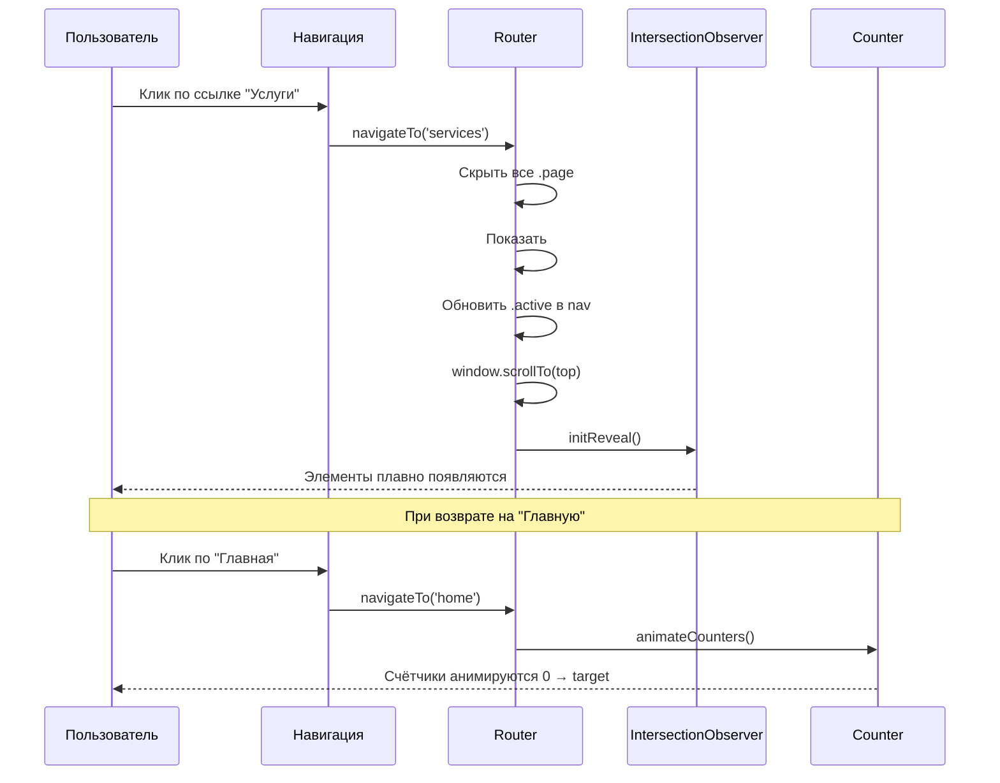
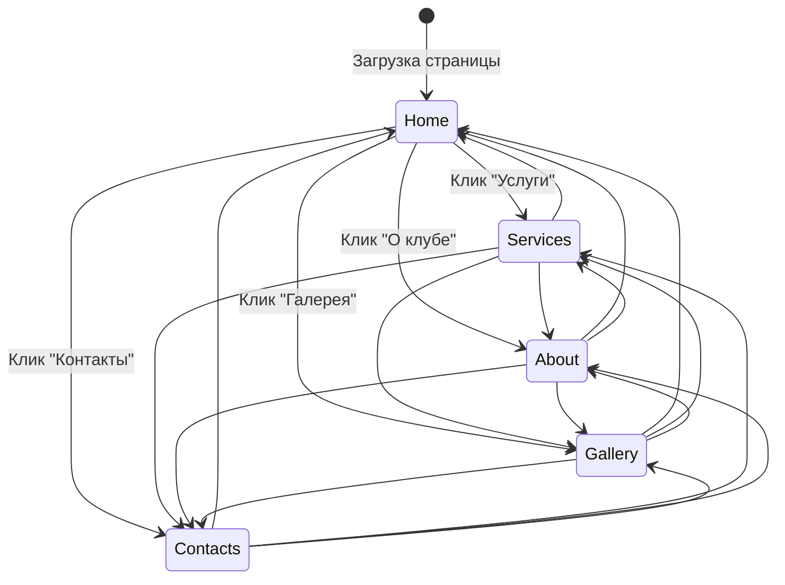
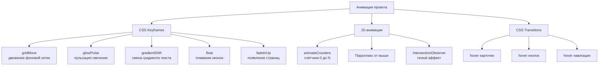
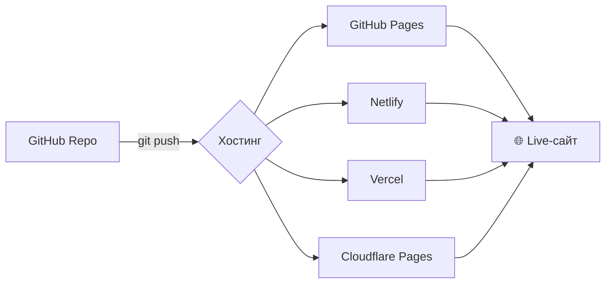
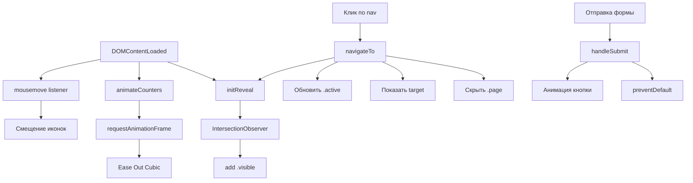

# ⚡ CYBERARENA — Компьютерный клуб


> Статический пятистраничный сайт для компьютерного клуба **CYBERARENA** с современным киберпанк-оформлением, анимациями и полной адаптивностью. Написан на чистом **HTML + CSS + JavaScript** без каких-либо внешних зависимостей и фреймворков.

---

## 📋 Содержание

- [Возможности](#-возможности)
- [Демо-страницы](#-демо-страницы)
- [Структура проекта](#-структура-проекта)
- [Архитектура](#-архитектура)
- [Навигация](#-навигация)
- [Анимации](#-анимации)
- [Установка и запуск](#-установка-и-запуск)
- [Адаптивность](#-адаптивность)
- [Кастомизация](#-кастомизация)
- [Браузеры](#-браузеры)
- [Лицензия](#-лицензия)

---

## ✨ Возможности

| Функция                    | Описание                                                        |
| -------------------------- | --------------------------------------------------------------- |
| 🎨 **Киберпанк-дизайн**    | Тёмная тема с неоновыми градиентами и эффектом glassmorphism    |
| 🚀 **SPA-навигация**       | Переключение страниц без перезагрузки                           |
| 💫 **Анимации**            | Плавное появление, параллакс, hover-эффекты, счётчики           |
| 📱 **Адаптивность**        | Корректная работа на мобильных, планшетах и десктопах           |
| ⚡ **Zero-dependency**     | Никаких фреймворков, библиотек и сборщиков                      |
| 🎯 **Интерактив**          | Форма обратной связи, счётчики статистики, параллакс от курсора |
| 🖱️ **Кастомный скроллбар** | Градиентный скроллбар в стиле проекта                           |

---

## 📄 Демо-страницы

Сайт состоит из **5 страниц**, переключаемых через навигацию:



### 🏠 Главная

Приветственный экран с анимированным градиентным заголовком, статистикой клуба и плавающими иконками.

### 💰 Услуги

Шесть тарифных планов: **Стандарт**, **Премиум** (выделен как «Хит»), **Ночной**, **Турнирный**, **Командный**, **Студенческий**.

### ℹ️ О клубе

История, оснащение и ключевые преимущества киберклуба.

### 🖼️ Галерея

Шесть зон клуба с hover-эффектами увеличения.

### 📞 Контакты

Адрес, телефон, email, режим работы и рабочая форма обратной связи.

---

## 📁 Структура проекта



> 💡 Проект намеренно реализован как **один файл `index.html`** со встроенными CSS и JS для максимальной простоты развёртывания. При желании легко разделить на `style.css` и `script.js`.

```
cyberarena/
└── index.html    # Весь проект: HTML + CSS + JS
```

---

## 🏗️ Архитектура

### Общая схема работы



### Взаимодействие компонентов



---

## 🧭 Навигация

Логика переключения страниц реализована через функцию `navigateTo(pageId)`:



**Ключевые моменты:**

- Каждая страница — это `<section class="page" id="...">`
- Активная страница получает класс `.active` (отображается через `display: block`)
- Неактивные страницы скрыты (`display: none`)
- Переключение сопровождается анимацией `fadeInUp`

---

## 💫 Анимации

В проекте используется **8+ типов анимаций**, все на чистом CSS и JS:



### Тайминги

| Анимация        | Длительность | Тип                    |
| --------------- | ------------ | ---------------------- |
| `gridMove`      | 20s          | linear, infinite       |
| `glowPulse`     | 8s           | ease-in-out, alternate |
| `gradientShift` | 4s           | ease, infinite         |
| `float`         | 6s           | ease-in-out, infinite  |
| `fadeInUp`      | 0.6s         | ease, однократно       |
| Счётчики        | 2s           | ease-out cubic         |

---

## 🚀 Установка и запуск

### Способ 1: Прямое открытие

```bash
# Клонируйте репозиторий
git clone https://github.com/yourusername/cyberarena.git

# Перейдите в папку
cd cyberarena

# Откройте index.html в браузере
# Windows:
start index.html
# macOS:
open index.html
# Linux:
xdg-open index.html
```

### Способ 2: Локальный сервер (рекомендуется)

```bash
# Python 3
python -m http.server 8000

# Node.js (npx)
npx serve

# PHP
php -S localhost:8000
```

Затем откройте [http://localhost:8000](http://localhost:8000)

### Способ 3: Деплой

Проект готов к размещению на любом статическом хостинге:



---

## 📱 Адаптивность

Сайт адаптирован под 3 основные категории устройств:

```mermaid
graph LR
    subgraph Desktop["🖥️ Desktop (от 769px)"]
        D1[Полная навигация в ряд]
        D2[Многоколоночные сетки]
        D3[Большие hero-заголовки]
    end

    subgraph Tablet["📱 Mobile (до 768px)"]
        T1[Навигация в колонку]
        T2[Одноколоночные сетки]
        T3[Увеличенный padding]
        T4[Кнопки на всю ширину]
    end

    subgraph Small["📱 Small (до 480px)"]
        S1[Статистика 2 колонки]
        S2[Карточки 1 колонка]
        S3[Уменьшенные шрифты]
    end

    Desktop --> Tablet --> Small
```



**Контрольные точки:**

- `@media (max-width: 768px)` — планшеты и мобильные
- `@media (max-width: 480px)` — компактные смартфоны

---

## 🎨 Кастомизация

### Цветовая схема

Основные цвета заданы в CSS. Для смены палитры найдите и замените:

```css
/* Главные акценты */
#00c8ff  /* голубой неон */
#a855f7  /* фиолетовый */
#ff0096  /* розовый */
#0a0a1a  /* тёмный фон */
```

### Тарифы

Тарифы находятся в секции `#services` в виде карточек `.card`. Для добавления нового тарифа скопируйте блок:

```html
<div class="card reveal">
	<div class="card-icon">🎯</div>
	<h3>Название</h3>
	<p>Описание</p>
	<div class="price">XXX ₽ <span>/ час</span></div>
	<ul>
		<li>Пункт 1</li>
		<li>Пункт 2</li>
	</ul>
	<a
		href="#"
		class="btn btn-outline"
		onclick="navigateTo('contacts'); return false;"
		>Выбрать</a
	>
</div>
```

### Статистика

Измените значения атрибута `data-target` в блоке `.stat-card`:

```html
<div class="stat-number" data-target="50">0</div>
```

### Параллакс

Настройте чувствительность параллакса в JS:

```javascript
const x = (e.clientX / window.innerWidth - 0.5) * 20; // измените 20
const y = (e.clientY / window.innerHeight - 0.5) * 20;
```

---

## 🌐 Браузеры

| Браузер | Версия | Поддержка |
| ------- | ------ | --------- |
| Chrome  | 90+    | ✅ Полная |
| Firefox | 88+    | ✅ Полная |
| Safari  | 14+    | ✅ Полная |
| Edge    | 90+    | ✅ Полная |
| Opera   | 76+    | ✅ Полная |

**Используемые технологии:**

- `backdrop-filter` (требует современного браузера)
- `IntersectionObserver API`
- CSS `background-clip: text`
- CSS Grid / Flexbox
- CSS Custom Properties (переменные в перспективе)

---

## 🛠️ Технические детали

### Ключевые функции JavaScript



### Производительность

- ✅ **Аппаратное ускорение:** анимации на `transform` и `opacity`
- ✅ **Пассивные слушатели:** для `scroll` и `mousemove`
- ✅ **IntersectionObserver:** вместо `scroll`-события для reveal
- ✅ **CSS-анимации:** вместо JS там, где возможно
- ✅ **Единый файл:** 1 HTTP-запрос вместо 3+

---

## 📝 Лицензия

Проект распространяется под лицензией **MIT**. Используйте свободно в личных и коммерческих целях.

```
MIT License

Copyright (c) 2025 CYBERARENA

Permission is hereby granted, free of charge, to any person obtaining a copy
of this software and associated documentation files (the "Software"), to deal
in the Software without restriction, including without limitation the rights
to use, copy, modify, merge, publish, distribute, sublicense, and/or sell
copies of the Software, and to permit persons to whom the Software is
furnished to do so, subject to the following conditions:

The above copyright notice and this permission notice shall be included in all
copies or substantial portions of the Software.
```

---

## 🤝 Вклад в проект

1. Fork репозитория
2. Создайте ветку (`git checkout -b feature/AmazingFeature`)
3. Закоммитьте изменения (`git commit -m 'Add some AmazingFeature'`)
4. Push в ветку (`git push origin feature/AmazingFeature`)
5. Откройте Pull Request

---

## 📞 Контакты

**CYBERARENA**

- 📍 г. Москва, ул. Киберспортивная, 42
- 📞 +7 (999) 123-45-67
- ✉️ info@cyberarena.ru
- 🕐 Работаем 24/7

---

<div align="center">

**Сделано с ⚡ для геймеров**

⭐ Поставьте звезду, если проект был полезен!

</div>
